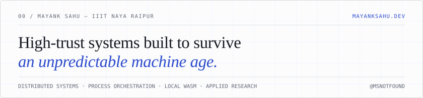

<a href="https://mayanksahu.dev">
  <picture>
    <source media="(prefers-color-scheme: dark)" srcset="./assets/hero-dark.svg">
    
  </picture>
</a>

  <a href="https://mayanksahu.dev"><b>mayanksahu.dev</b></a> &nbsp;·&nbsp;
  <a href="mailto:hello@mayanksahu.dev">hello@mayanksahu.dev</a> &nbsp;·&nbsp;
  <a href="https://github.com/msnotfound?tab=repositories">Repositories</a> &nbsp;·&nbsp;
  <a href="https://github.com/msnotfound/msnotfound.github.io/tree/main/papers">Research</a>

<picture>
  <source media="(prefers-color-scheme: dark)" srcset="./assets/systems-dark.svg">
  
</picture>

### Now & Focus

- **B.Tech in Data Science & AI @ IIIT Naya Raipur** (`2024 – 2028`)
- **Agent Infrastructure** — building [`fleetorch`](https://github.com/msnotfound/fleetorch) (parallel AI coding agents in isolated git worktrees) and researching cost-amortized desktop automation (*Phantom*)
- **Local & Deterministic AI** — building [`mnemium`](https://github.com/msnotfound/mnemium) (offline-first second brain for AI chats) and [`tropicam`](https://github.com/msnotfound/tropicam) (training-free tropical semiring event vision)
- **Open for** — AI systems, agent infrastructure, and backend engineering roles / collaborations

---

### Flagship Systems

<table>
<tr>
<td width="50%" valign="top">

**[Draftdeckai](https://github.com/msnotfound/Draftdeckai)** · `79 ★`

100% open-source AI document creation platform — turn natural-language prompts into polished resumes, presentations, and CVs.

`TypeScript` `Next.js` `AI`

</td>
<td width="50%" valign="top">

**[fleetorch](https://github.com/msnotfound/fleetorch)**

Cross-platform Go CLI for spawning and supervising fleets of AI coding agents in parallel — one isolated git worktree per agent.

`Go` `Git Worktrees` `Agent Infra`

</td>
</tr>
<tr>
<td width="50%" valign="top">

**[tropicam](https://github.com/msnotfound/tropicam)**

Deterministic, CPU-only, training-free event-vision engine operating over the tropical (max-plus) semiring.

`Python` `Max-Plus Algebra` `Event Vision`

</td>
<td width="50%" valign="top">

**[mnemium](https://github.com/msnotfound/mnemium)**

Offline-first Chrome extension giving AI chats a private second brain — captures, distills, and injects context across ChatGPT, Claude, Gemini, Grok & DeepSeek.

`TypeScript` `Chrome Extension` `Local AI`

</td>
</tr>
<tr>
<td width="50%" valign="top">

**[ghostsignal](https://github.com/msnotfound/ghostsignal)**

Zero-knowledge trading-signal marketplace on Midnight — commit-reveal-verify keeps strategies private while track records remain publicly verifiable.

`TypeScript` `Midnight` `Zero-Knowledge`

</td>
<td width="50%" valign="top">

**[rl-emergency-traffic-control](https://github.com/msnotfound/rl-emergency-traffic-control)**

Deep-RL (PPO) traffic-signal control in SUMO prioritizing emergency vehicles — achieving ~70% faster ambulance travel vs fixed-time signals.

`Python` `PPO` `SUMO`

</td>
</tr>
</table>

<b>More systems &amp; prototypes</b> (structura, syntra, RetroShare, academic-helper)

 

- **[structura](https://github.com/msnotfound/structura)** — AI structural-engineering assistant: floor-plan analysis with IS 456:2000 design checks, 3D visualization, and cost estimation (`Python`)
- **[syntra](https://github.com/msnotfound/syntra)** — B2B Intelligence Delivery suite (`TypeScript`)
- **[RetroShare](https://github.com/msnotfound/RetroShare)** — Retro-themed S3 file sharing via 6-character codes (`Next.js`, `TypeScript`, `AWS S3`)
- **[academic-helper](https://github.com/msnotfound/academic-helper)** — Local RAG study assistant powered by Ollama + ChromaDB (`TypeScript`)

---

### Applied Research

- **[Phantom: A Middleware Layer for Cost-Amortized Agentic Desktop Automation](https://github.com/msnotfound/msnotfound.github.io/blob/main/papers/phantom.md)** — Compiles single demonstrations into parameterized execution graphs dispatched via AT-SPI with local `all-MiniLM-L6-v2` fallback (`$0` per-replay cost, break-even at $N^* = 1$).
- **[Semantic Artifact Navigation (SAN)](https://github.com/msnotfound/msnotfound.github.io/blob/main/papers/san-swg.md)** — Formalizing coordinate-free interaction with computational workbooks.

---

### Core Stack

  
  
  
  
  
  
  
  

