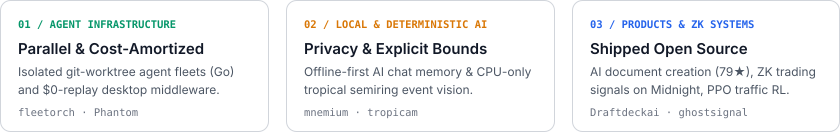

<a href="https://mayanksahu.is-a.dev">
  <picture>
    <source media="(prefers-color-scheme: dark)" srcset="./assets/hero-dark.svg">
    
  </picture>
</a>

  <a href="https://mayanksahu.is-a.dev"><b>mayanksahu.is-a.dev</b></a> &nbsp;·&nbsp;
  <a href="https://linkedin.com/in/mayank-sahu-89ba67325">LinkedIn</a> &nbsp;·&nbsp;
  <a href="mailto:108mayanksahu@gmail.com">108mayanksahu@gmail.com</a> &nbsp;·&nbsp;
  <a href="https://github.com/msnotfound?tab=repositories">Repositories</a> &nbsp;·&nbsp;
  <a href="https://github.com/msnotfound/msnotfound.github.io/tree/main/papers">Research</a>

<picture>
  <source media="(prefers-color-scheme: dark)" srcset="./assets/systems-dark.svg">
  
</picture>

### Summary

Distributed Systems & AI Infrastructure Engineer specializing in **low-level process orchestration**, **local-first WebAssembly engines**, and **high-reliability distributed backends**. B.Tech in Data Science & Artificial Intelligence at **IIIT Naya Raipur** (`2024 – 2028`).

---

### Flagship Systems

<table>
<tr>
<td width="50%" valign="top">

**[Fleetorch](https://github.com/msnotfound/fleetorch)** · `Go`

Low-overhead multi-agent process supervisor across isolated Git worktrees: **sub-15ms** bootstrap latency, cross-platform PTY multiplexing (`ConPTY` / `POSIX PTY`), and lock-free bounded ring buffers.

`Go` `POSIX PTY` `ConPTY` `Git Worktrees`

</td>
<td width="50%" valign="top">

**[Mnemium](https://github.com/msnotfound/mnemium)** · `WASM`

Local-first AI memory & context engine: `sqlite-vec` compiled to WebAssembly with zero-copy binary IPC (**< 12ms** 768-dim similarity search), SSE stream capture, and hybrid BM25 + dense SLM retrieval (`mnemiumd`).

`WebAssembly` `TypeScript` `Go` `sqlite-vec`

</td>
</tr>
<tr>
<td width="50%" valign="top">

**[HookGuard](https://github.com/msnotfound/hookguard)** · `Backend`

Enterprise webhook ingestion & delivery gateway: PostgreSQL Transactional Outbox, pre-flight DNS SSRF mitigation, timestamped HMAC-SHA256 + AES-256-GCM, DLQ replays, and Failure Lab chaos harness.

`Node.js` `PostgreSQL` `Redis` `BullMQ`

</td>
<td width="50%" valign="top">

**[Draftdeckai](https://github.com/msnotfound/Draftdeckai)** · `79 ★`

100% open-source AI document creation platform — turn natural-language prompts into polished resumes, presentations, and CVs.

`TypeScript` `Next.js` `AI`

</td>
</tr>
<tr>
<td width="50%" valign="top">

**[GhostSignal](https://github.com/msnotfound/ghostsignal)** · `ZK`

Verifiable AI trading-signal protocol on Midnight using zero-knowledge proofs and SHA-256 commit-reveal primitives for sub-second trade attestations without exposing model weights.

`Midnight ZK` `TypeScript` `WebSockets`

</td>
<td width="50%" valign="top">

**[Tropicam](https://github.com/msnotfound/tropicam)** · `Vision`

Deterministic, CPU-only, training-free event-vision engine operating over the tropical (max-plus) semiring.

`Python` `Max-Plus Algebra` `Event Vision`

</td>
</tr>
</table>

<b>More systems &amp; research prototypes</b> (rl-emergency-traffic-control, structura, syntra, RetroShare, academic-helper)

 

- **[rl-emergency-traffic-control](https://github.com/msnotfound/rl-emergency-traffic-control)** — Deep-RL (PPO) traffic-signal control in SUMO prioritizing emergency vehicles (~70% faster ambulance travel vs fixed-time signals) (`Python`, `PPO`, `SUMO`)
- **[structura](https://github.com/msnotfound/structura)** — AI structural-engineering assistant: floor-plan analysis with IS 456:2000 design checks, 3D visualization, and cost estimation (`Python`)
- **[syntra](https://github.com/msnotfound/syntra)** — B2B Intelligence Delivery suite (`TypeScript`)
- **[RetroShare](https://github.com/msnotfound/RetroShare)** — Retro-themed S3 file sharing via 6-character codes (`Next.js`, `TypeScript`, `AWS S3`)
- **[academic-helper](https://github.com/msnotfound/academic-helper)** — Local RAG study assistant powered by Ollama + ChromaDB (`TypeScript`)

---

### Applied Research

- **[Phantom: A Middleware Layer for Cost-Amortized Agentic Desktop Automation](https://github.com/msnotfound/msnotfound.github.io/blob/main/papers/phantom.md)** — Compiles single demonstrations into parameterized execution graphs dispatched via AT-SPI with local `all-MiniLM-L6-v2` fallback (`$0` per-replay cost, break-even at $N^* = 1$).
- **[Semantic Artifact Navigation (SAN)](https://github.com/msnotfound/msnotfound.github.io/blob/main/papers/san-swg.md)** — Formalizing coordinate-free interaction with computational workbooks.

---

### Technical Stack

- **Languages:** `Go` · `Rust` · `TypeScript` · `Python` · `C++` · `SQL (PostgreSQL, SQLite)`
- **Systems & Low-Level:** `POSIX PTYs / ConPTY` · `Linux cgroups v2 / Namespaces` · `WebAssembly (WASM)` · `mmap` · `Bounded Ring Buffers`
- **Distributed Systems & Storage:** `Transactional Outbox / WAL` · `sqlite-vec` · `Redis / BullMQ` · `Raft` · `Blake3 CAS` · `AES-256-GCM`

  
  
  
  
  
  
  
  

